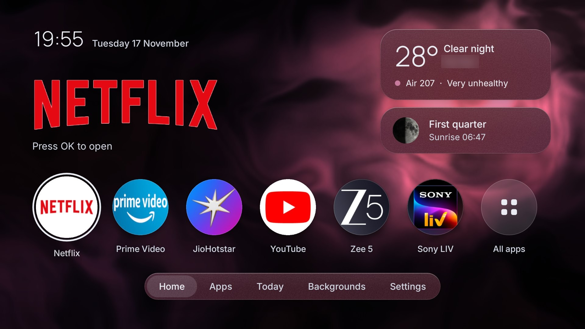
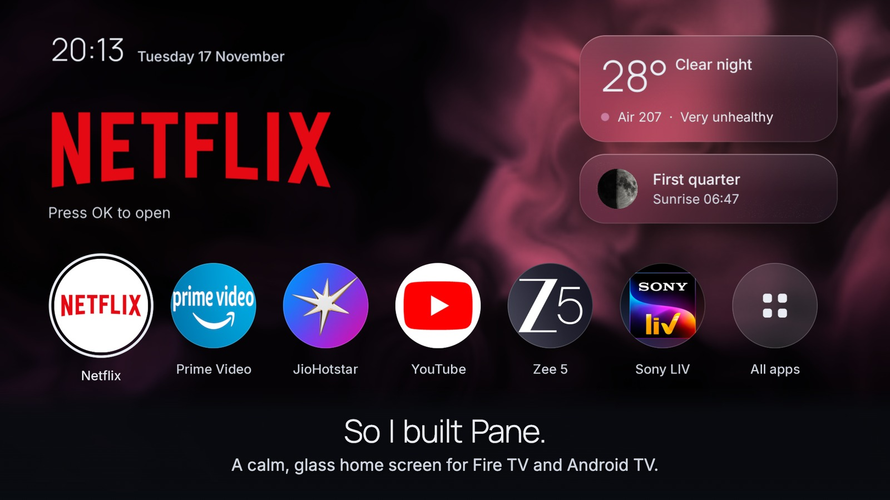
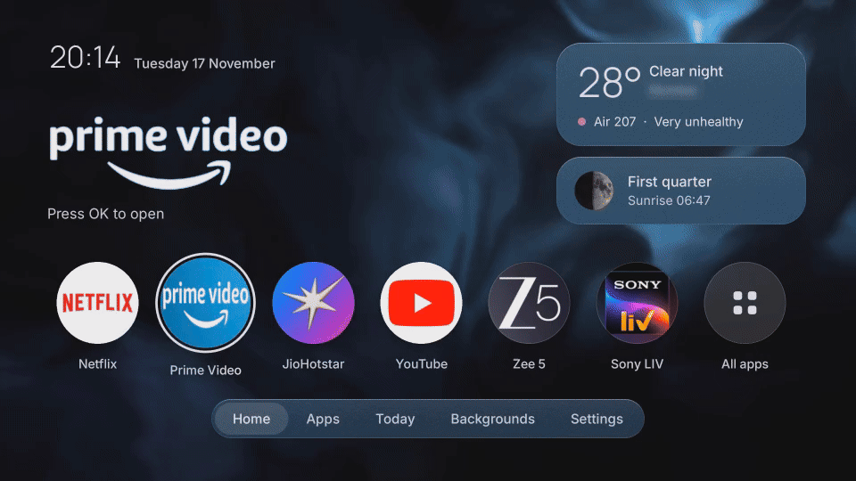
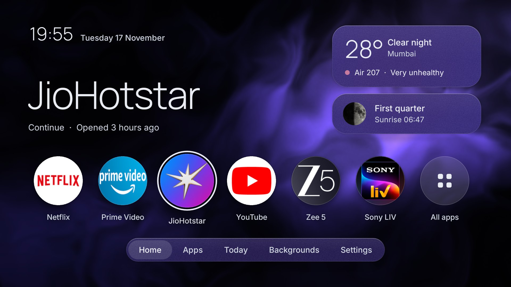
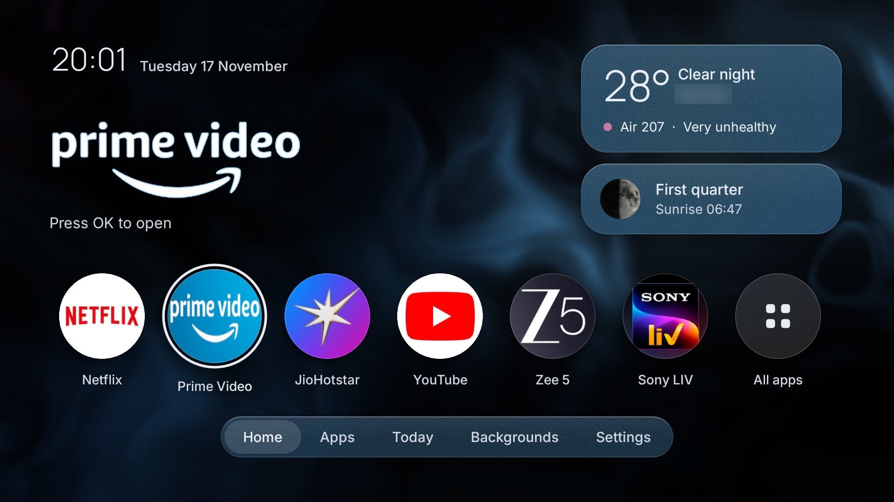
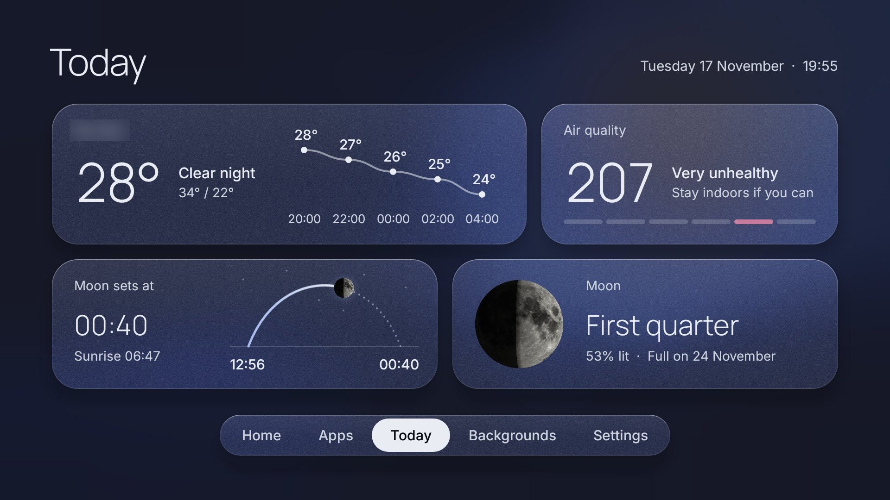
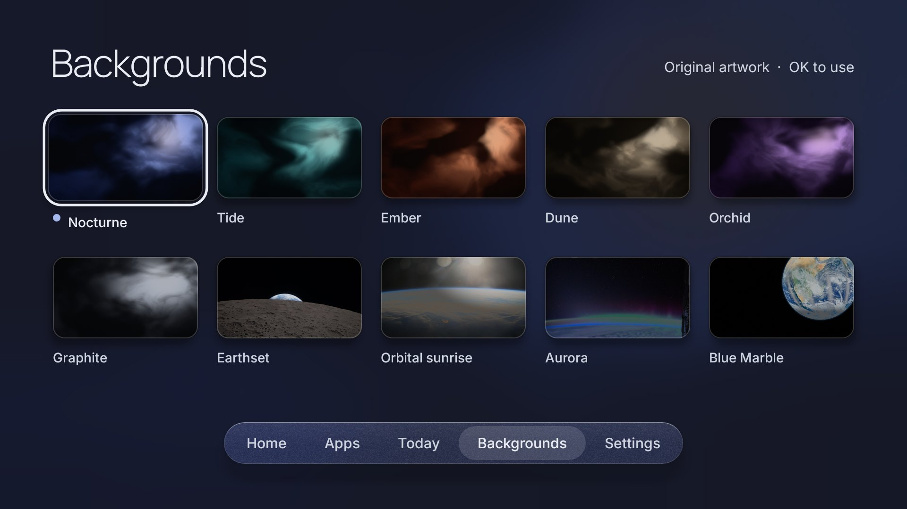
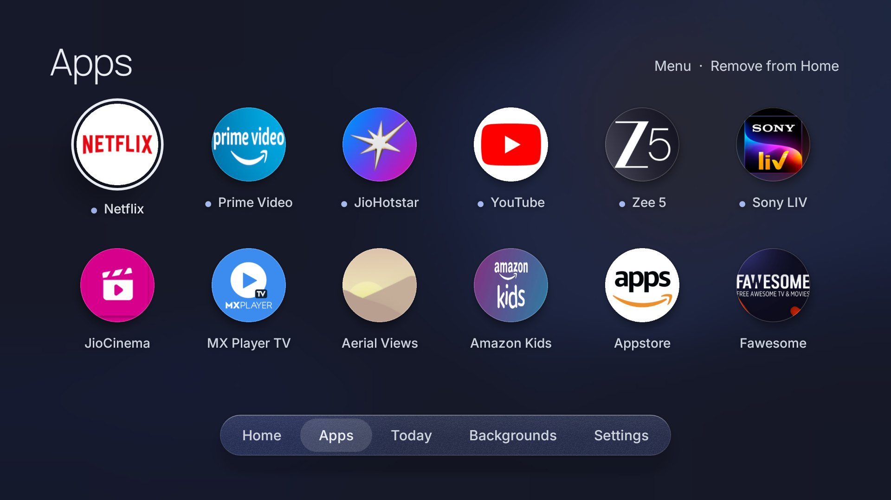
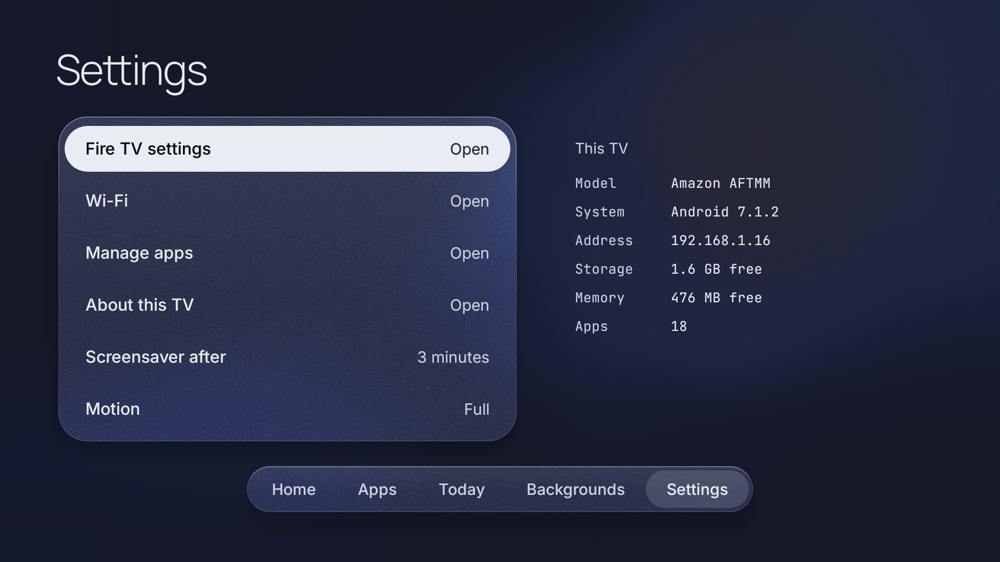

<div align="center">



# Pane

**The glass home screen for your TV.**

A free, open-source home screen for Amazon Fire TV and Android TV. No ads, no accounts, no tracking.

[](https://github.com/Arya-A-Nair/pane-tv/releases/latest)
[](LICENSE)

[**Download the APK**](https://github.com/Arya-A-Nair/pane-tv/releases/latest/download/pane.apk) · [Install in one command](#install) · [Watch the video](#see-it-move)

</div>

---

Fire TV's home screen is a billboard. Half of it sells you shows, the other half sells you apps, and the thing you actually wanted is somewhere in a row of ads.

Pane replaces it with something calm: your apps, the time, the sky outside, and a living room of light behind glass. It's built for the whole family. Two buttons get you anywhere, and nothing is hidden behind gestures.

## See it move

<a href="https://github.com/Arya-A-Nair/pane-tv/releases/download/v1.0.0/pane-launch.mp4"></a>



<sub>Made from Pane running on a 2018 Fire TV Stick 4K; the smoke is Pane's own shader.</sub>

## What you get

<table>
  <tr>
    <td width="50%"></td>
    <td width="50%"></td>
  </tr>
  <tr>
    <td><b>A home that's alive.</b> Volumetric smoke drifts behind frosted glass. Move to another app and its colour spreads through the smoke like dye in water.</td>
    <td><b>Your apps, nothing else.</b> Round icons for the apps you use. Newly installed apps join by themselves. No sponsored rows, ever.</td>
  </tr>
  <tr>
    <td></td>
    <td></td>
  </tr>
  <tr>
    <td><b>Today, at a glance.</b> Live weather and air quality for your city, sunrise and sunset, and the real moon at tonight's phase, travelling its actual path across the night sky.</td>
    <td><b>Backgrounds worth looking at.</b> Six living smoke fields that drift and take on your app's colour, or NASA photographs of Earth from orbit, all behind real frosted glass.</td>
  </tr>
  <tr>
    <td></td>
    <td></td>
  </tr>
  <tr>
    <td><b>Every app, one page away.</b> Pin or unpin with the menu button.</td>
    <td><b>Fire TV settings stay one press away.</b> Pane never hides the system: display, sound and remotes are always reachable.</td>
  </tr>
</table>

**Also:** an ambient mode that turns the screen into a slow window when nobody's watching, small spring-based motion everywhere you look, and a reduced-motion setting if you prefer it still.

## Install

### Fire TV (recommended way)

Amazon doesn't let other apps replace the Fire TV home screen, so Pane needs a one-time setup from a computer on the same Wi-Fi. It takes about two minutes.

1. On the TV: **Settings → My Fire TV → Developer options → ADB debugging → On**.
   (No Developer options? Go to **Settings → My Fire TV → About** and press OK on your device name seven times.)
2. Find the TV's IP address: **Settings → My Fire TV → About → Network**.
3. On your computer, run the installer:

**macOS / Linux**
```sh
curl -fsSL https://raw.githubusercontent.com/Arya-A-Nair/pane-tv/main/install/pane-install.sh | bash -s -- 192.168.1.20
```

**Windows (PowerShell)**
```powershell
iwr https://raw.githubusercontent.com/Arya-A-Nair/pane-tv/main/install/pane-install.ps1 -OutFile pane-install.ps1
powershell -ExecutionPolicy Bypass -File .\pane-install.ps1 192.168.1.20
```

4. A prompt appears on the TV: choose **Always allow from this computer**, then **OK**.

That's it. Press Home on your remote and Pane appears. (Amazon briefly holds the Home button for a few seconds before Pane takes over; Pane shows a calm screen instead of Amazon's ads while it waits.)

The installer downloads the latest signed release, checks its checksum, installs it, and grants the two permissions Pane needs. It's safe to run again to update.

### Google TV / Android TV

Download [`pane.apk`](https://github.com/Arya-A-Nair/pane-tv/releases/latest/download/pane.apk), install it (for example with the *Downloader* app or *Send Files to TV*), then press Home and choose **Pane** as your home app.

### Remove it

```sh
adb uninstall tv.pane
```
Your TV goes straight back to its original home screen. Pane never changes system files.

## How it works

- **The home screen** is a plain-Java Android app with no third-party libraries, small enough to run smoothly on a 2018 Fire TV Stick (1.5 GB RAM).
- **The smoke** is a fragment shader rendered on the GPU at 30 fps. Frosted glass samples a pre-blurred copy of the background at each panel's exact position, because Fire OS has no blur API.
- **The moon** is rendered on the device from NASA's lunar surface map. Its phase, rise and set times come from standard astronomical formulas, worked out offline.
- **Taking over Home on Fire TV:** a small watcher notices when Amazon's home screen opens and brings Pane forward. It needs permission to read system logs, which the installer grants once over ADB.

The design language is documented in [DESIGN.md](DESIGN.md).

## Requirements

- Fire TV (Fire OS 6 or newer) or Android TV / Google TV running Android 5.1 or newer.
- For the Fire TV setup: a computer on the same Wi-Fi with [adb](https://developer.android.com/tools/releases/platform-tools) (the installer tells you how to get it).
- Tested on a Fire TV Stick 4K (2018). Other devices should work; please [report how it goes](https://github.com/Arya-A-Nair/pane-tv/issues/new/choose).

## Privacy

Pane has no accounts, no analytics and no ads. The only network requests are for the weather: your approximate location comes from your public IP address (ip-api.com), and the weather and air quality for that location come from Open-Meteo. Details in [PRIVACY.md](PRIVACY.md).

## Build from source

```sh
./build.sh                 # needs JDK 17+, Android build-tools 35 and platform 25
PANE_TV=192.168.1.20 ./deploy.sh
```
See [CONTRIBUTING.md](CONTRIBUTING.md) (AI agents: [AGENTS.md](AGENTS.md)) for a map of the code, how to test without a TV and what's most useful to work on. Please follow the [Code of Conduct](CODE_OF_CONDUCT.md). Releases are built and signed by GitHub Actions; see [docs/RELEASING.md](docs/RELEASING.md).

## Credits

- Earth and Moon imagery: NASA (public domain), including the Artemis II "Earthset" and International Space Station photography.
- Moon surface map: NASA Lunar Reconnaissance Orbiter (public domain).
- Weather and air quality: [Open-Meteo](https://open-meteo.com) (CC BY 4.0). Location: [ip-api.com](https://ip-api.com).
- Fonts: [Manrope](https://github.com/sharanda/manrope), [Inter](https://rsms.me/inter/) and [JetBrains Mono](https://www.jetbrains.com/lp/mono/) (SIL Open Font License).

App names and icons shown in screenshots belong to their owners. Pane isn't affiliated with Amazon, Google or any of them.

## License

[MIT](LICENSE) © 2026 Arya Nair
